# Expense Voucher Management System

An expense voucher workflow application with a NestJS REST API, a React frontend, and MySQL persistence through Prisma.

## Requirements

- Node.js 22 or newer and npm
- MySQL 8 or a compatible MySQL server

## Project Setup

### 1. Configure the database and backend

Create a MySQL database (for example, `expense_voucher`) and a database user with access to it. Configure the backend environment:

```text
backend/.env
```

Set `DATABASE_URL` to the MySQL connection string and set `JWT_ACCESS_SECRET` to a random secret of at least 32 characters. The API uses port `3000` by default; set `PORT` to override it. Do not commit `.env` or real credentials.

Install backend dependencies and generate the Prisma client:

```bash
cd backend
npm install --legacy-peer-deps
npm run db:generate
```

Apply the checked-in database migrations:

```bash
npm run db:deploy
```

Create user accounts with the seed script. Supply `SEED_USERS_JSON` temporarily through your shell or a secret manager. Each account needs `email`, `fullName`, `role` (`EMPLOYEE`, `DIRECTOR`, or `ACCOUNTS`), and a password of at least 12 characters; `employeeId` is optional. There is no public registration endpoint.

Start the backend from the `backend` directory:

```bash
npm run start:dev
```

The API is available at `http://localhost:3000/api`. `GET /api` is the health check.

### 2. Install and start the frontend

In another terminal:

```bash
cd frontend
npm install
npm run dev
```

Vite serves the frontend at `http://localhost:5173` and proxies `/api` requests to `http://localhost:3000`. To use a different API origin, configure `VITE_API_BASE_URL` in the frontend environment. Sign in with an account created by the backend administrator.

## Demo Walkthrough

Open `http://localhost:5173` after starting both apps. These credentials are for the local demo only.

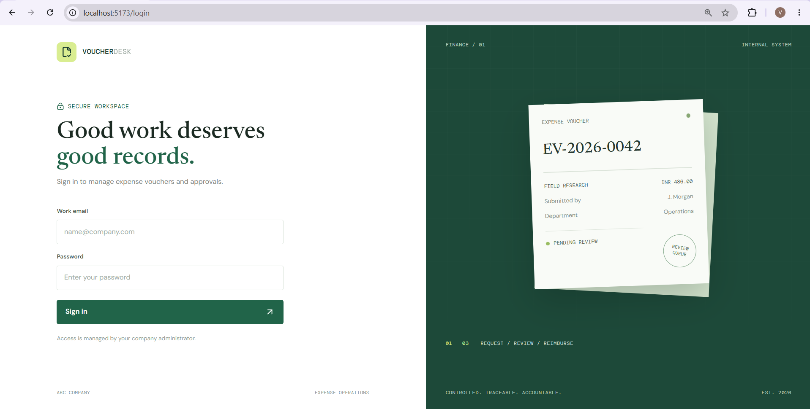

| Role     | Email                       | Password            |
| -------- | --------------------------- | ------------------- |
| Employee | `demo.employee@example.com` | `DemoEmployee2026!` |
| Director | `demo.director@example.com` | `DemoDirector2026!` |
| Accounts | `demo.accounts@example.com` | `DemoAccounts2026!` |

### 1. Employee creates and submits a voucher

Sign in as Employee to see personal totals and recent vouchers.

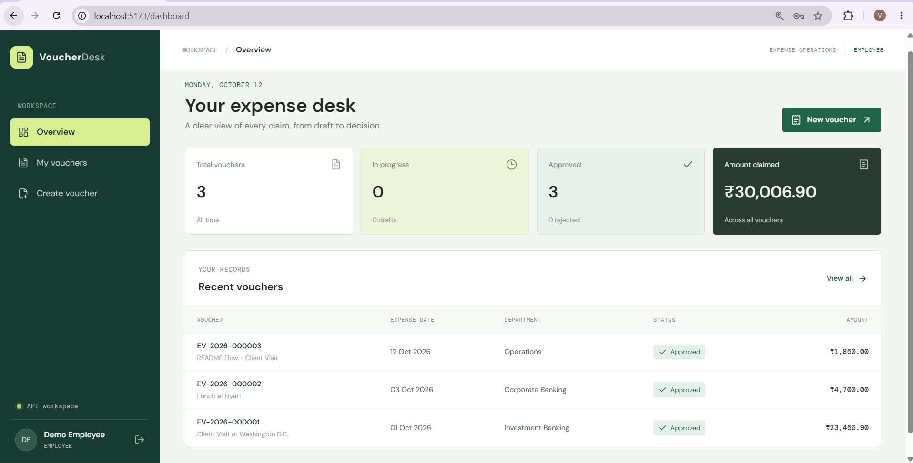

Choose **Create voucher** and enter the expense details. The blank form is shown first, followed by an example with the fields completed.

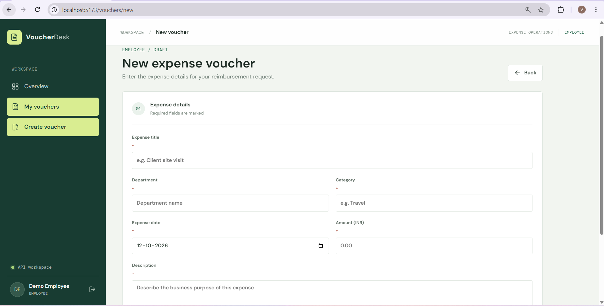

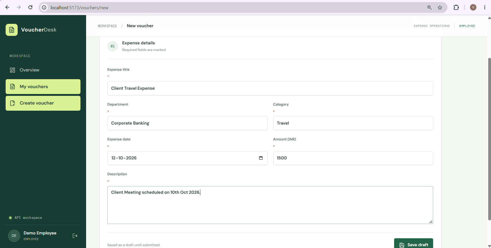

Save the voucher as a draft, open its details, upload the employee signature, and choose **Submit for approval**. The detail screen shows the signed voucher ready to submit; after submission, the employee overview shows it as pending approval.

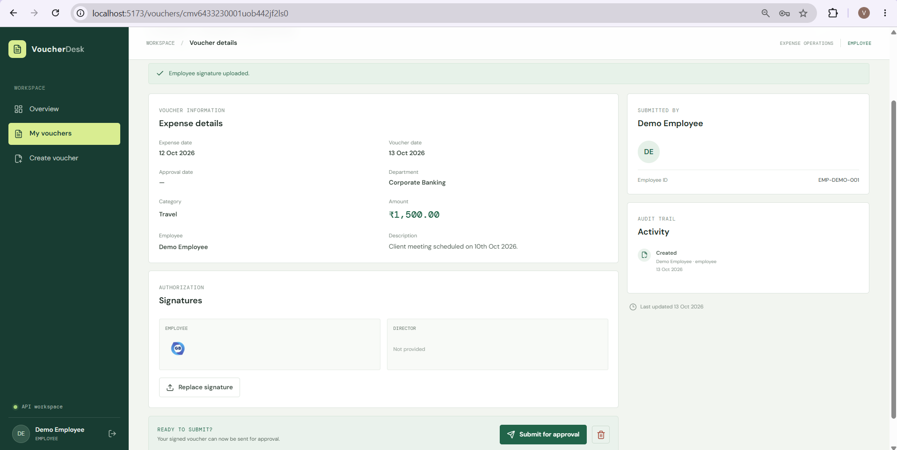

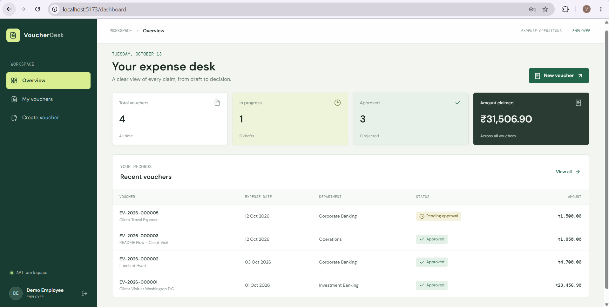

### 2. Director reviews submitted vouchers

Sign in as Director. The approval overview summarizes pending requests and recent activity. Open **Approval queue** and select the submitted voucher to inspect its details and audit trail.

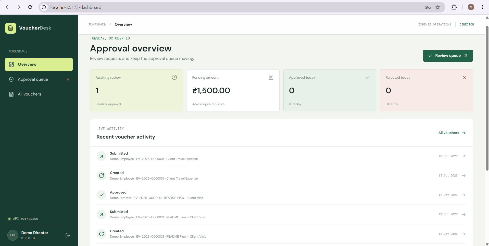

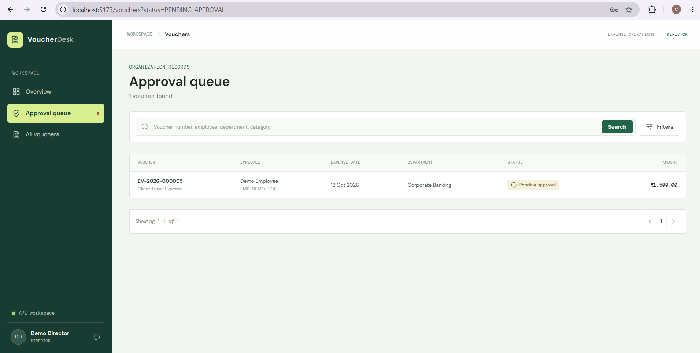

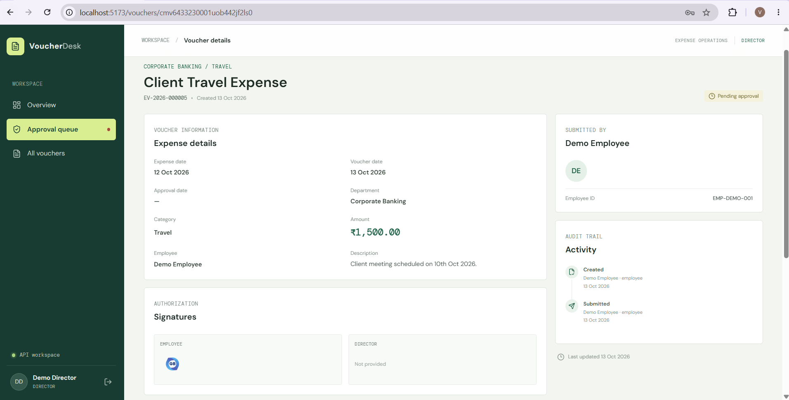

The Director can approve by uploading a signature, or reject by entering a reason. The decision controls are shown below. The all-vouchers view then shows the voucher's resulting status.

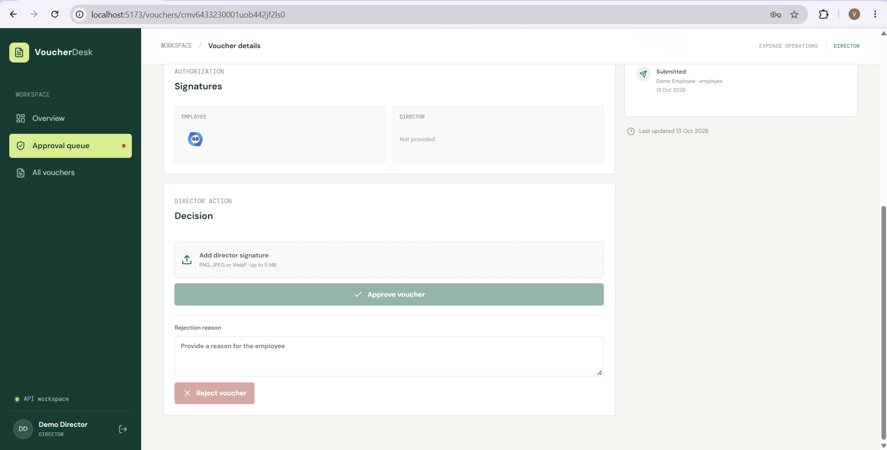

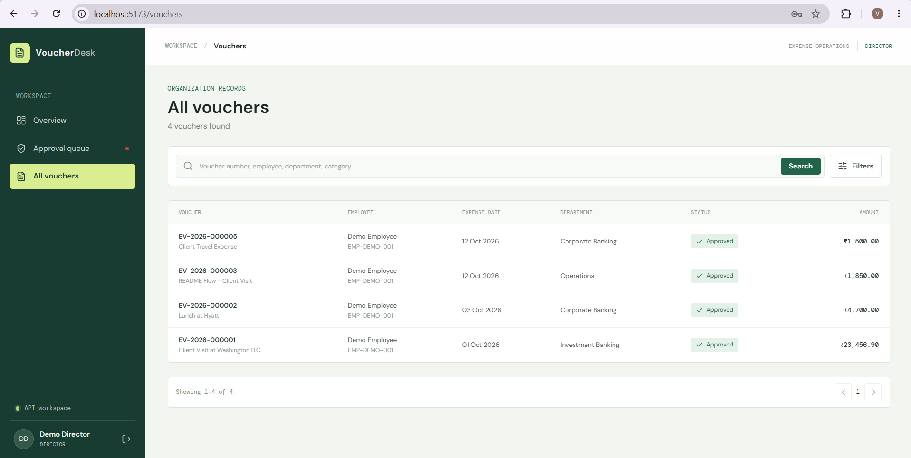

### 3. Accounts reviews approved expenses

Sign in as Accounts to review approved expenses across the organization. The overview summarizes voucher totals and recently approved expenses; payment processing itself is outside this system.

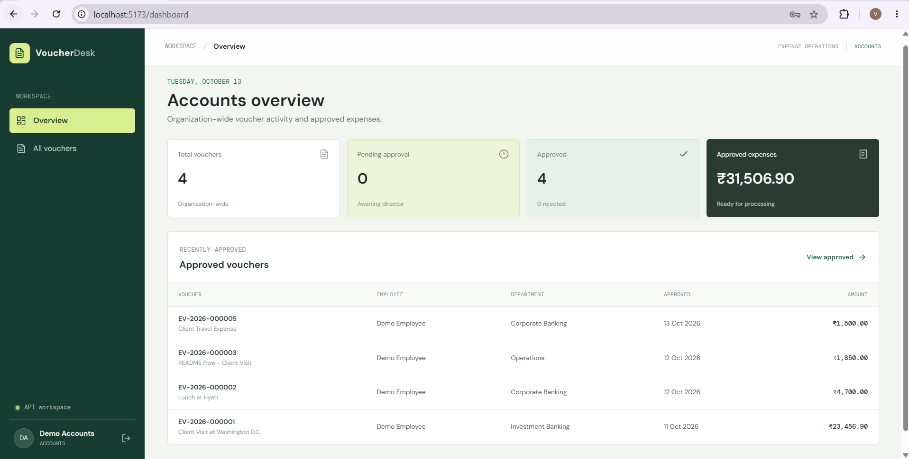

Open **All vouchers** for the organization-wide list. Accounts can view vouchers across the organization but cannot perform workflow actions.

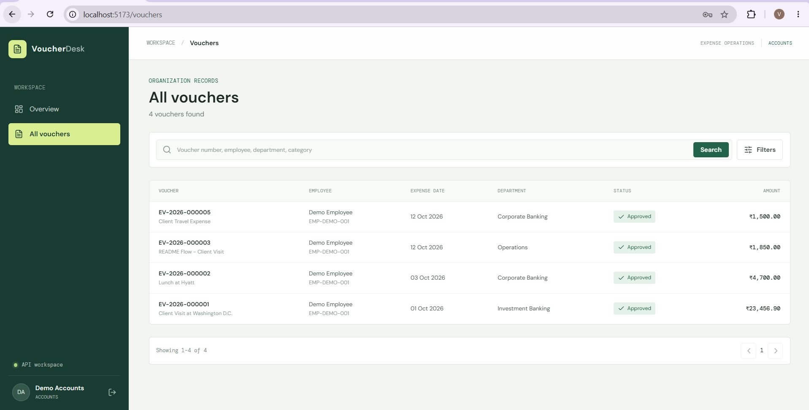

The normal status path is `DRAFT` → `PENDING_APPROVAL` → `APPROVED` or `REJECTED`. Approved and rejected vouchers are terminal and cannot be edited or resubmitted.

### Useful commands

Run these from the relevant app directory:

| Backend             | Purpose                       |
| ------------------- | ----------------------------- |
| `npm run build`     | Build and type-check the API  |
| `npm test`          | Run backend unit tests        |
| `npm run test:e2e`  | Run backend end-to-end tests  |
| `npm run lint`      | Lint backend source and tests |
| `npm run db:studio` | Open Prisma Studio            |

| Frontend          | Purpose                           |
| ----------------- | --------------------------------- |
| `npm run build`   | Type-check and build the frontend |
| `npm test`        | Run frontend tests                |
| `npm run lint`    | Lint the frontend                 |
| `npm run preview` | Preview a production build        |

## Database Schema

The schema is defined in [`backend/prisma/schema.prisma`](backend/prisma/schema.prisma). MySQL stores voucher amounts as `DECIMAL(12,2)`; timestamps are stored as dates, and Prisma generates CUID identifiers.

| Model            | Purpose and relationships                                                                                                                                                                                     |
| ---------------- | ------------------------------------------------------------------------------------------------------------------------------------------------------------------------------------------------------------- |
| `User`           | Login identity, email, name, optional employee ID, password hash, active flag, and role. A user can own vouchers, create audit events, and hold refresh sessions.                                             |
| `Voucher`        | Expense details, generated unique voucher number, owner, employee identity snapshot, status, signature storage keys, rejection reason, and approval date. Has many audit events. Amounts use `DECIMAL(12,2)`. |
| `VoucherCounter` | Stores the next voucher sequence independently for each year.                                                                                                                                                 |
| `VoucherEvent`   | Append-only workflow history with event type, actor, optional before/after statuses, details, and timestamp. References a voucher and the acting user.                                                        |
| `RefreshSession` | Stores a unique SHA-256 token hash, user, expiry, and optional revocation timestamp; raw refresh tokens are not stored.                                                                                       |

Roles are `EMPLOYEE`, `DIRECTOR`, and `ACCOUNTS`. Voucher statuses are `DRAFT`, `PENDING_APPROVAL`, `APPROVED`, and `REJECTED`. Voucher event types are `CREATED`, `UPDATED`, `SUBMITTED`, `APPROVED`, and `REJECTED`.

The voucher workflow is `DRAFT` → `PENDING_APPROVAL` → `APPROVED` or `REJECTED`. Only draft vouchers may be edited or deleted. Approved and rejected vouchers are terminal. Employee identity is snapshotted on the voucher so later account changes do not rewrite historical vouchers. Signature files are stored outside the database (default: `backend/storage/signatures`) and accessed through authenticated API routes.

## API Documentation

The API details here follow [`backend/output.md`](backend/output.md). All routes use the `/api` prefix. The default base URL is `http://localhost:3000/api`. JSON request validation rejects unknown fields and transforms validated input.

### Authentication

Login returns a short-lived access token and a refresh token. Send the access token on protected requests:

```http
Authorization: Bearer <accessToken>
```

Refresh rotates the refresh token; logout revokes the supplied refresh session. Both accept a JSON body containing `refreshToken`. Refresh tokens should be treated as secrets.

### Endpoint reference

| Method | Endpoint                                | Access    | Description                                           |
| ------ | --------------------------------------- | --------- | ----------------------------------------------------- |
| GET    | `/api`                                  | Public    | Health check                                          |
| POST   | `/api/auth/login`                       | Public    | Authenticate with email and password                  |
| POST   | `/api/auth/refresh`                     | Public    | Rotate a refresh token                                |
| POST   | `/api/auth/logout`                      | Public    | Revoke a refresh session                              |
| GET    | `/api/dashboards/me`                    | All roles | Role-specific dashboard metrics                       |
| POST   | `/api/vouchers`                         | Employee  | Create a draft voucher                                |
| GET    | `/api/vouchers`                         | All roles | Search, filter, sort, and paginate vouchers           |
| GET    | `/api/vouchers/:id`                     | All roles | Get voucher details and event history                 |
| PATCH  | `/api/vouchers/:id`                     | Employee  | Update an owned draft voucher                         |
| DELETE | `/api/vouchers/:id`                     | Employee  | Delete an owned draft voucher                         |
| POST   | `/api/vouchers/:id/signatures/employee` | Employee  | Upload the employee signature                         |
| POST   | `/api/vouchers/:id/submit`              | Employee  | Submit a signed draft for approval                    |
| POST   | `/api/vouchers/:id/approve`             | Director  | Approve a pending voucher with signature              |
| POST   | `/api/vouchers/:id/reject`              | Director  | Reject a pending voucher with a reason                |
| GET    | `/api/vouchers/:id/signatures/:kind`    | All roles | Retrieve an authorized employee or director signature |

Employees can access only vouchers they created. Directors and Accounts can view vouchers across the organization. Accounts access is read-only for workflow actions.

